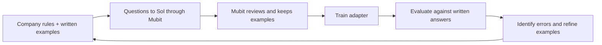

# Mubit Project: Dialytics — Analytics, but with company dialect

**Every company speaks its own dialect of data. Dialytics teaches a lightweight model to understand yours.**

- The same analytics question can mean different things at different companies.
- **Active customer:** one company counts a login in the last week; another requires a payment in the last 30 days.
- **Churn:** one company counts cancellations; another waits until a customer has gone 60 days without paying.
- **Revenue:** one team reports gross payments; another subtracts refunds. Both may simply ask, “How much did we make?”

## The problem

- Frontier models do not arrive knowing a company's internal workbooks, metric definitions or reporting conventions.
- Sometimes the correct interpretation exists only in the evaluator's head. A plausible answer can still mean the wrong thing to that business.
- Even with written instructions, models can misread defaults, aliases and ambiguous requests. Repeated analytics work needs consistent company-specific interpretation.

## The goal

- Train a **lightweight adapter** that reliably translates business questions into the company's structured analytics language.
- Use **Mubit** to learn from frontier-model calls, select examples and train a specialised model.
- Aim for frontier-level accuracy on this recurring task, with fast responses and a smaller model footprint.

## Example company: Canary Labs

- Our demo uses a fictional subscription business with **Starter, Team and Business** plans.
- Its [company rules](dialect/company.json) define the meaning of each metric, customer state and reporting period.
- A fixed reference date of **24 October 2026**, UTC periods and GBP amounts make expected answers reproducible.

| Concept | Canary Labs' dialect |
| --- | --- |
| Active customer | Paid on the snapshot date or preceding 29 days, and is not cancelled. Logins do not count. |
| Churned customer | Previously paid, then cancelled or went at least 60 days without a qualifying payment. |
| Trial customer | Signed up but has never made a qualifying payment by the snapshot. |
| Revenue | Net revenue: qualifying payments minus refunds recorded within the period. |
| Customer count | A snapshot at the selected period's end, capped at the reference date. |

### A sample question

> How many active users do we have in Britain on the Team plan?

```json
{
  "metric": "count_customers",
  "filter": "active",
  "period": "today",
  "group_by": null,
  "plan": "Team",
  "country": "GB"
}
```

- **“Active users”** selects paying customers under Canary's definition.
- **“Britain”** becomes `GB`; an omitted date for customer counts becomes `today`.
- The prototype produces a structured query specification. Executing it against a database is the next extension.

## The learning loop



1. **Define the dialect:** capture business definitions, defaults, filters and ambiguity rules.
2. **Write the evaluations:** pair questions with expected JSON answers before scoring model outputs.
3. **Collect teacher responses:** send questions to `gpt-6-sol` through Mubit with a stable task prompt.
4. **Train with Mubit:** let it review examples and build the task adapter.
5. **Measure and improve:** compare the adapter with Sol, Luna and Mini; use failures to guide the next iteration.

Expected answers stay outside model requests and are used for scoring. The first training-and-evaluation cycle is complete; a further correction-and-retraining cycle is future work.

## Training and results

### Adapter v1 successfully trained

- **160 task calls recorded by Mubit**, with **68 examples kept** for its learning pipeline.
- **Adapter v1 trained successfully** on **Qwen3-4B-Instruct-2507**, a 4B-parameter base model.
- **92.3% on Mubit's internal test**: 12 of 13 cases passed, compared with 30.8% for the base model plus prompt.
- The adapter reached **silent testing at 10%** and can answer questions in Mubit's Try models interface.


### Our 25-question evaluation

**The 4B adapter beats GPT-4.1 Mini by 24 percentage points and finishes just one correct answer behind GPT-6 Luna.**

| Model | Correct / 25 | Exact-match accuracy | Average response latency |
| --- | ---: | ---: | ---: |
| GPT-6 Sol | 25 / 25 | 100% | 1,553 ms |
| GPT-6 Luna | 21 / 25 | 84% | 2,126 ms |
| **Dialytics adapter v1 · Qwen3 4B** | **20 / 25** | **80%** | **970 ms*** |
| GPT-4.1 Mini | 14 / 25 | 56% | 635 ms |

- **Strong on supported queries:** 20 of 21 correct (**95.2%**), with valid output structure on all 25 answers.
- **Close to Luna:** a four-percentage-point gap on this set, using a specialised 4B model.
- **Reported subsecond average:** 970 ms for the adapter, below the recorded Sol and Luna averages; Mini remains fastest.
- **Clear next improvement:** four failures guessed an answer instead of asking for clarification; one missed a country filter.

*Adapter latency is a manually reported average. API timings measure complete responses including network time; Sol and Luna used medium reasoning. Runs and timing boundaries differ, so this is an indicative comparison.*

The 25 questions form a curated diagnostic set selected using observed model responses. Scores describe this set; Mubit's separate 13-case test is shown above.

### Written evaluations and evidence

- **Scoring:** parse JSON, validate the schema, then require an exact match to the written expected answer, ignoring key order.
- **Strict company contract:** required `null` values and period tokens must match; extra fields fail validation.
- **Shared questions:** all four models are compared against the same 25 expected answers. Adapter responses were collected manually.

| Evidence | What to inspect |
| --- | --- |
| [25-question evaluation set](questions/25_q_eval_set.json) | Numbered questions and expected answers. |
| [Model comparison](evaluations/demo-025-comparison.json) | Each model's answer, correctness and recorded API latency. |
| [Adapter evaluation](evaluations/adapter-025-evaluation.json) | Adapter score, failure analysis and latency context. |
| [Submitted adapter answers](questions/adapter_answer.md) | The manually collected responses. |

### Training and evaluation screenshots

**Task overview:** Mubit groups the analytics calls into one task and shows v1 running in a 10% silent test.


**Successful training:** Mubit marks the v1 training run as passed.


**Learning pipeline:** 160 task calls and 68 kept examples, with v1 in silent testing.


**Mubit's internal evaluation:** 92.3% across 13 test cases, separate from our 25-question comparison.


**Adapter in action:** a German churn question becomes a structured query with the requested quarter and plan grouping.


## Run locally

- Requires **Node.js 22+** and a Mubit key with provider access or supported starter credit.
- Install dependencies and add your key to a local `.env` file:

```bash
npm install
```

```dotenv
MUBIT_API_KEY=your_mubit_key
```

Send one question:

```bash
npm start -- q_001
```

Preview a batch, then remove `--dry-run` to send it:

```bash
npm run send:mubit -- --source questions/review-002.json --from q_101 --count 50 --dry-run
```

- Requests and responses are saved under `dialect/results/`.
- The batch runner skips matching completed calls and stops on failure.
- The [task lock](dialect/task-lock.json) keeps the company prompt, model settings and output contract consistent.
