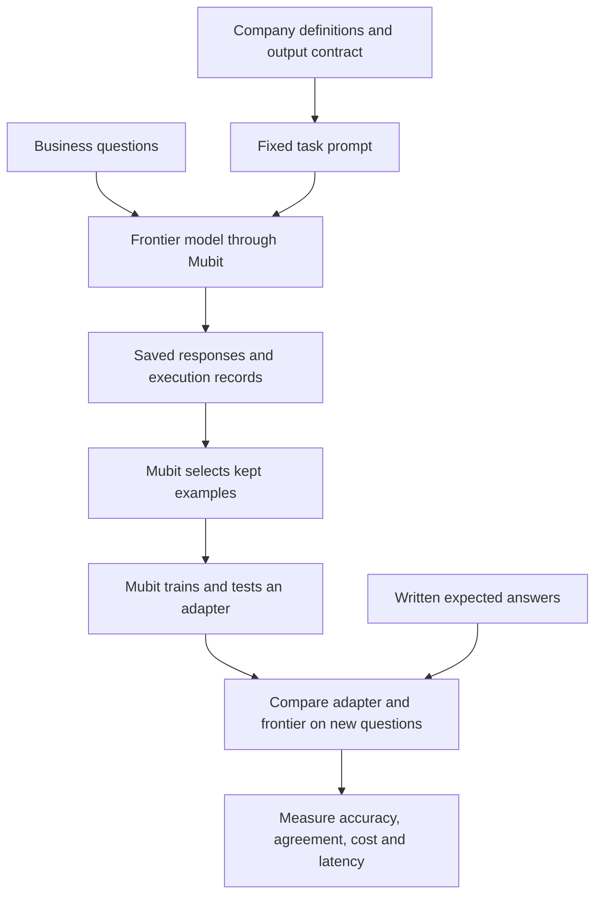

# Dialect

**Every company speaks its own dialect of its data. Dialect learns yours.**

Dialect explores how a company can turn its recurring analytics questions into a specialised model through Mubit. A frontier model first interprets questions using the company's business definitions. Mubit records those calls, selects examples, and trains a task-specific adapter. Written evaluations then measure whether the adapter interprets new questions as accurately as the frontier model.

The goal is frontier-level performance on this company's defined analytics task, with lower cost and latency. Adapter parity and efficiency gains are targets to measure, rather than results already established by this repository.

## The problem

Business questions depend on company-specific meaning. An “active customer” might be someone who paid recently, rather than someone who logged in. “Revenue” might mean revenue after refunds. “Churned” might include cancelled customers and customers who have stopped paying, with precise rules for each.

A model can produce valid JSON or SQL while misunderstanding those definitions. Dialect makes the company's rules explicit, writes expected answers for representative questions, and uses repeated question-answer traffic to support training and evaluation.

## The example company: Canary Labs

Canary Labs is a fictional subscription business with Starter, Team and Business plans. Its definitions live in [`dialect/company.json`](dialect/company.json).

| Business concept | Canary Labs definition |
| --- | --- |
| Active customer | Has a qualifying payment on the snapshot date or preceding 29 days, and is not cancelled. Logins do not establish active status. |
| Churned customer | Previously paid and is either cancelled or at least 60 days past their latest qualifying payment. |
| Trial customer | Has signed up but has never made a qualifying payment by the snapshot. |
| Revenue | Defaults to net revenue: qualifying payments minus refunds recorded within the period. |
| Customer count | A snapshot at the end of the selected period, capped at the reference date. |

The reference date is fixed at **24 October 2026**, with UTC calendar periods and GBP amounts, so the same question has a stable expected interpretation.

For example:

> How many active users do we have in Britain on the Team plan?

Expected interpretation:

```json
{
  "metric": "count_customers",
  "filter": "active",
  "period": "today",
  "group_by": null,
  "plan": "Team",
  "country": "GB"
}
```

This captures three company rules: “active users” means paying customers, Britain maps to `GB`, and a customer count without a date defaults to today.

The current output is a structured query specification. Database execution, SQL compilation and numerical business results are future extensions.

## How the learning loop works



1. **Define the company's language.** Specify metrics, customer states, date defaults, supported filters and how to handle ambiguity.
2. **Write questions and expected answers.** Cover normal requests, paraphrases, company-specific meanings and unsupported requests.
3. **Send questions through Mubit.** The current teacher is `gpt-6-sol`. Each request includes the same company instructions and output contract, plus a different user question.
4. **Let Mubit collect and train.** Mubit selects kept examples and trains an adapter when the task meets its eligibility requirements. Its documented default first-training threshold is 25 kept examples; submitted calls and kept examples are different counts.
5. **Compare the trained adapter with the frontier model.** Mubit tests adapter versions against provider answers. Passing versions can be compared in its Try models interface.
6. **Evaluate both against the written answers.** Determine whether matching the frontier model also preserves the company's intended meaning.

The runner sends the question and fixed instructions; the local `expected` answer is reserved for evaluation. It does not automatically upload those labels as supervised corrections. Analyst feedback is part of the intended loop, but its effect on Mubit training still needs to be confirmed.

See Mubit's [first-adapter guide](https://docs.mubit.ai/guides/first-adapter) for training and comparison, and [task and session rules](https://docs.mubit.ai/guides/tasks-and-sessions) for how calls are grouped.

## Written evaluations

Dialect includes explicit evaluation cases rather than treating every frontier response as correct.

| Artifact | Contents |
| --- | --- |
| [`questions/review-001.json`](questions/review-001.json) | 100 questions, each with an expected JSON answer. |
| [`questions/review-002.json`](questions/review-002.json) | 100 additional questions with expected answers. |
| [`dialect/contract-examples.json`](dialect/contract-examples.json) | 18 written examples with expected answers and explanations of the applicable rules. |
| [`dialect/query-spec.schema.json`](dialect/query-spec.schema.json) | The output contract used to judge structural validity. |
| [`evaluations/mubit-pilot_001.json`](evaluations/mubit-pilot_001.json) | A recorded pilot evaluation with schema checks and field-by-field comparisons. |

The cases cover metric selection, customer status, relative and named periods, country aliases, plan filters, grouping and default behaviour. They also check when the model should return `needs_clarification` or `unsupported` instead of guessing.

### Scoring a response

The evaluation procedure is:

1. Confirm the request completed and the answer was not truncated.
2. Parse the answer as JSON and validate it against the schema.
3. Compare the parsed object with the written expected answer, ignoring object key order.
4. Require every expected field, including explicit `null` values for unused dimensions, and reject additional fields.
5. Record the overall exact match and which fields differ.

JSON-object response mode ensures JSON syntax; schema validity and business correctness require these separate checks.

The saved pilot passes all recorded checks. The current runners save responses without scoring them, and a reusable batch evaluation command has not yet been implemented.

### Matching is different from correctness

| Measurement | Question it answers |
| --- | --- |
| Adapter–frontier agreement | How often does the adapter return the same interpretation as the frontier model? |
| Frontier accuracy | How often does the frontier model match the written expected answer? |
| Adapter accuracy | How often does the adapter match the written expected answer? |
| Field-level accuracy | Which parts of the interpretation are causing errors? |
| Cost and latency | What does each model cost, and how quickly does it respond under comparable conditions? |

An adapter can agree with an incorrect frontier answer. Both agreement and independent correctness matter.

To establish frontier-level performance, evaluate both models on the same fresh, labelled questions, using the same company definitions. Report exact-match accuracy, error categories, sample size and the difference between the models against a predeclared acceptable tolerance. Measure cost and latency separately.

The review batches have been used to generate training traffic, so they cannot establish independent generalisation for questions already submitted. A separate held-out evaluation set must remain outside training traffic. Mubit's own test split and Dialect's independent evaluation serve different purposes.

## Current progress

As of 24 October 2026:

- The company definitions, fixed prompt, JSON schema and task lock are implemented.
- There are 200 written question–answer cases and 18 explanatory contract examples.
- Local logs record **150 successful calls** for the current Canary Labs task, including the first 50 questions from `review-002.json`.
- Requests, responses, token usage, latency and Mubit request IDs are saved locally.
- One pilot has a saved passing evaluation.
- Completed adapter training, aggregate evaluation scores and frontier-level adapter performance have not yet been verified in the repository.

The separate product-summary experiment under `experiments/` is outside the Canary Labs training task and its evaluation counts.

## Run locally

Requires Node.js 22 or later and a Mubit key with provider access or supported starter credit.

```bash
npm install
```

Create a local `.env` file:

```dotenv
MUBIT_API_KEY=your_mubit_key
```

Send one question through Mubit:

```bash
npm start -- q_001
```

Select a question from the second file:

```bash
npm start -- --source questions/review-002.json q_101
```

Single-question commands send a new request each time. To preview a batch without sending calls:

```bash
npm run send:mubit -- --source questions/review-002.json --from q_101 --count 50 --dry-run
```

To submit the next 50 questions:

```bash
npm run send:mubit -- --source questions/review-002.json --from q_151 --count 50
```

The batch runner skips matching completed records for the current task and stops on a failed request. Calls consume provider access or starter credit. Outputs are written to `dialect/results/`; evaluation is a separate step.

Keep the company prompt, schema, model and output format stable during collection. [`dialect/task-lock.json`](dialect/task-lock.json) records the task configuration, and the runners check it before sending requests.

## Project structure

```text
dialect/
  company.json             Company glossary and business rules
  task.mjs                 Fixed prompt, model settings and lock check
  task-lock.json           Recorded task configuration
  query-spec.schema.json   Output contract
  contract-examples.json   Written examples and rule explanations
  results/                 Saved model calls
questions/                 Labelled question batches
evaluations/               Saved correctness evaluations
index.mjs                  Single-question Mubit runner
send-mubit.mjs             Batch Mubit runner
test-openai.mjs            Optional direct-provider response collection
experiments/               Separate exploratory tasks
dialect-project-brief.md   Detailed project background and roadmap
```
